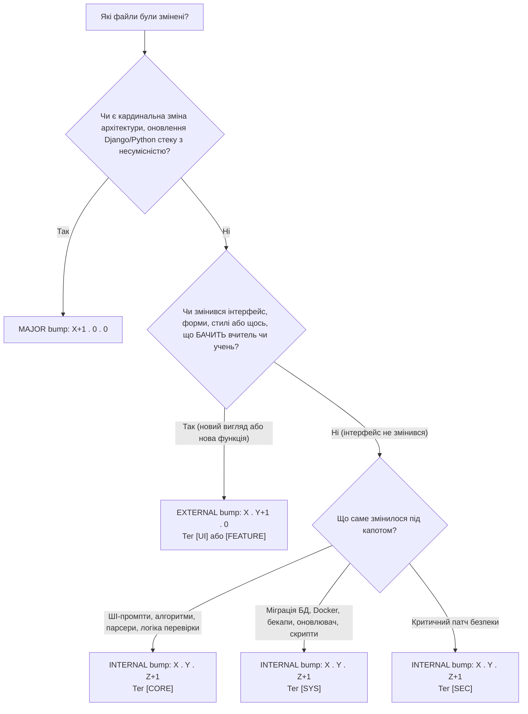

# Стандарт та політика нумерації версій SchoolNet (Scope-based SemVer)

> **Призначення документа:** Цей документ є обов'язковим стандартом для розробників та будь-яких систем штучного інтелекту (AI-асистентів, LLM, Copilot), які вносять зміни чи формують релізи у репозиторії `schoolwork2`.

---

## 1. Загальний принцип

Платформа SchoolNet використовує **Scope-based Semantic Versioning (трирівневу модель сфери впливу)**:

$$\text{Версія} = \mathbf{MAJOR} \,.\, \mathbf{EXTERNAL} \,.\, \mathbf{INTERNAL}$$

Формат рядка версії: `X.Y.Z` (наприклад, `4.10.1`, `4.11.0`, `5.0.0`).

### Значення сегментів:

1. **`MAJOR` (X) — Кардинальна зміна платформи:**
   - Несумісні зміни архітектури, оновлення базового стеку розгортання (перехід на нову мажорну версію Python/Django/Docker, кардинальна зміна протоколів зв'язку або формату даних бекапів).
   - Збільшує `X`, скидає `Y` і `Z` на `0` (наприклад: `4.10.1` $\to$ `5.0.0`).

2. **`EXTERNAL` (Y) — Зовнішній шар (User & UI / Функціонал користувачів):**
   - **Будь-які зміни, помітні для кінцевих користувачів — вчителів або учнів**:
     - Нові сторінки, нові кнопки, зміна форм (створення завдання, фільтри, здача робіт).
     - Зміни у візуальних стилях (`static/css/`, `theme.css`), шрифтах, темах (світла/темна), адаптивності для мобільних екранів.
     - Зміни поведінки публічних сторінок (сторінка входу `/access/`, QR-коди, запрошення до класів).
     - Зміни або додавання навчального контенту (програми курсів 5–11 класів).
   - Збільшує `Y`, скидає `Z` на `0` (наприклад: `4.10.1` $\to$ `4.11.0`).

3. **`INTERNAL` (Z) — Внутрішній шар (Core & Logic / Системні виправлення):**
   - **Зміни «під капотом», де користувач зовні не бачить змін в інтерфейсі**:
     - Алгоритми штучного інтелекту: промпти, guardrails, паспорти файлів (AST, Excel CF/formuls, DOCX, Scratch), evidence gates, ліміти токенів, квоти API.
     - Безпека: rate-limit, brute-force throttle, перевірки C2PA, валідація вхідних даних.
     - База даних: міграції, індекси, оптимізація запитів (усунення N+1, `select_related`).
     - Інфраструктура: Dockerfile, `compose.yaml`, скрипти бекапів, відновлення, служба оновлення (`updater_service.py`), тунелі Tailscale.
     - Багфікси бекенду та рефакторинг, що не змінюють інтерфейс користувача.
   - Збільшує `Z` (наприклад: `4.10.0` $\to$ `4.10.1`).

> [!NOTE]
> **Категорично заборонено** використовувати безсистемні літерні суфікси на кшталт `4.8.13a` ... `4.8.13n`. Всі виправлення мають бути строго числовими згідно з цим стандартом.

---

## 2. Маркування релізів тегами (Scope Tags)

Усі релізи в [CHANGELOG.md](../CHANGELOG.md), [RELEASES.json](../RELEASES.json) та [feed/changelog.py](../feed/changelog.py) **обов'язково** містять префікс сфери впливу у назві релізу:

| Тег | Сфера змін | Коли застосовувати | Приклад заголовка |
| :--- | :--- | :--- | :--- |
| **`[UI]`** | Зовнішній інтерфейс | Зміни шаблонів HTML, стилів CSS, клієнтського JS, форми, кнопки, редизайн, сторінки доступу. | `[UI] Центрування публічної сторінки доступу та мобільна адаптація` |
| **`[CORE]`** | Внутрішнє ядро | Алгоритми оцінювання ШІ, prompt engineering, техпаспорти файлів, валідація, безпека оцінювання. | `[CORE] Доказове оцінювання без галюцинацій: техпаспорти файлів та guardrails` |
| **`[SYS]`** | Системні/Інфраструктура | Міграції БД, Docker, compose, служба оновлень, бекапи, налаштування веб-сервера. | `[SYS] Політика нумерації версій та прямий healthz-ендпоінт` |
| **`[SEC]`** | Безпека | Термінові патчі вразливостей, обмеження доступу, захист від атак (throttle, DoS limits). | `[SEC] Посилений захист входу від перебору паролів` |

---

## 3. Алгоритм прийняття рішень для ШІ та розробників (Decision Tree)

Перед тим як створити реліз або підвищити версію, дайте відповіді на такі запитання:



### Швидка шпаргалка за каталогами:
- Зміни в `templates/`, `static/css/`, `static/js/`: $\to$ **`EXTERNAL` (Y)** або **`INTERNAL [UI]`** (для дрібного виправлення верстки).
- Зміни в `feed/gemini_service.py`, `feed/ai_context.py`, `feed/scratch_utils.py`: $\to$ **`INTERNAL` (Z)** з тегом **`[CORE]`**.
- Зміни в `feed/migrations/`, `Dockerfile`, `compose.yaml`, `scripts/updater_service.py`, `scripts/backup.sh`: $\to$ **`INTERNAL` (Z)** з тегом **`[SYS]`**.
- Додавання нового функціоналу для вчителя (нові налаштування, нові поля): $\to$ **`EXTERNAL` (Y)**.

---

## 4. Обов'язковий чек-лист файлів при випуску релізу

При підвищенні версії **обов'язково синхронно оновлюються 4 файли**:

1. **`VERSION`** — один рядок з версією (наприклад, `4.10.1`).
2. **`RELEASES.json`** — додати новий об'єкт на початок масиву:
   ```json
   {
     "version": "4.10.1",
     "date": "2026-11-15",
     "title": "[SYS] Політика нумерації версій (Scope-based SemVer) та правила для ШІ",
     "changes": [
       "Пункт 1...",
       "Пункт 2..."
     ]
   }
   ```
3. **`CHANGELOG.md`** — додати новий блок зверху:
   ```markdown
   ## [4.10.1] - 2026-11-15 - [SYS] Політика нумерації версій (Scope-based SemVer) та правила для ШІ
   - Пункт 1...
   - Пункт 2...
   ```
4. **`feed/changelog.py`**:
   - Оновити константи:
     ```python
     SITE_VERSION = "4.10.1"
     SITE_VERSION_SHORT = "v4.10.1"
     ```
   - Додати новий запис на початок списку `CHANGELOG_DATA` з полями `version`, `date`, `badge`, `student_changes`, `teacher_changes`.

---

## 5. Автоматична валідація

Перед створенням коміту завжди запускайте скрипт валідації:
```bash
python3 scripts/check_version_policy.py
```
Він автоматично перевіряє:
- Чи збігаються версії в усіх чотирьох файлах (`VERSION`, `RELEASES.json`, `feed/changelog.py`, `CHANGELOG.md`).
- Чи відповідає номер формату SemVer (`\d+\.\d+\.\d+`).
- Чи містить заголовок релізу обов'язковий тег сфери (`[UI]`, `[CORE]`, `[SYS]`, `[SEC]`).

---

## 6. Політика Docker на локальному ПК розробника
- **Тестове призначення**: Локальний ПК є робочою станцією, а не сервером школи. Образи створюються виключно для тестів і верифікації.
- **Очищення після тесту**: Не накопичувати старі збірки та OCI-шари. Зупиняти контейнери (`docker compose down`) та очищати образи.
- **Вимкнене автозавантаження**: Зберігати `restart: "no"` у всіх `compose*.yaml`.
