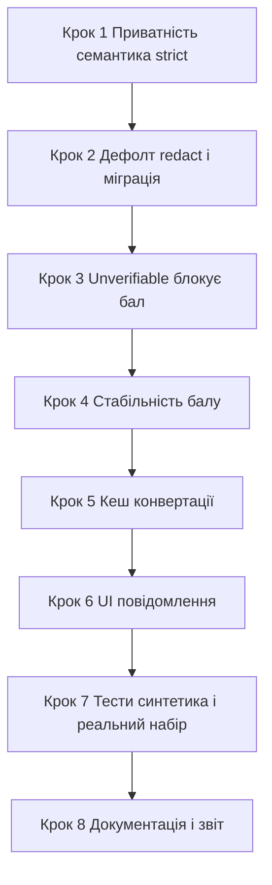

# План: придатна приватність і стабільне оцінювання ШІ

Дата: 08.11.2026
Версія: 4.8.13a (база — 4.8.13)
Статус: **реалізовано в робочій копії** (кроки 1–8). Звіт: [`docs/audits/AI_PRIVACY_AND_GRADING_FIX_2026-11-08.md`](../audits/AI_PRIVACY_AND_GRADING_FIX_2026-11-08.md). Тести: 31/31 пройдено в контейнері. Розгортання на робочий сервер і прогін реального набору — окремим кроком.

## 1. Мета

Зробити ШІ-перевірку робіт придатною для щоденного використання:

- звичайні документи (PDF, фото, зображення) не блокуються через сам формат;
- повідомлення честно розрізняють «виявлено реальні персональні дані» і «режим обмежує формат»;
- бал не зберігається, якщо хоч один активний критерій або ГР не підтверджено;
- бал стабільний між повторами (єдине джерело істини, без множинних перезаписів);
- конвертації медіа не повторюються для кожної резервної моделі;
- наявні оцінки, історія та спроби учнів збережені; експерименти — на копії.

## 2. Затверджені архітектурні рішення

### Рішення A — модель приватності

- Режим за замовчуванням — `redact`: очищення тексту + дозвіл візуальних матеріалів з EXIF-очищенням і честним попередженням, що пікселі не анонімізуються.
- `strict` лишається явним вибором для чутливих випадків, але його семантика змінюється: блокувати лише за реально виявлені дані, а не за формат.
- Заборонено видавати вилучення EXIF або регулярні вирази за повну анонімізацію зображень.
- Заборонено приховувати проблему простим вимкненням захисту без пояснення, що саме передається.

### Рішення B — unverifiable блокує числовий бал

- Якщо будь-який активний критерій або ГР має статус `unverifiable`, числовий `suggested_grade` НЕ зберігається.
- Повертається `assessment_blocked = true` з поясненням, який саме критерій/ГР не підтверджено.
- Бал стає доступним лише після ручної перевірки вчителем.

## 3. Поточний стан коду (підтверджено читанням)

### 3.1 Приватність — дефект «блокування за формат»

[`feed/ai_privacy.py`](../feed/ai_privacy.py:67) — `Redactor.media()`:

```python
def media(self, media):
    if media and self.mode == 'strict':
        raise PrivacyBlocked('Суворе знеособлення: візуальні матеріали можуть містити імена, ...')
```

Будь-який медіафайл у `strict` блокується незалежно від того, чи є в ньому персональні дані. Це і є головний дефект.

Дефолт режиму:

- [`feed/models.py`](../feed/models.py:3500) — `privacy_mode = models.CharField(..., default='strict', ...)`
- [`feed/migrations/0073_ai_parallel_privacy.py`](../feed/migrations/0073_ai_parallel_privacy.py:37) — `default='strict'`
- [`feed/views.py`](../feed/views.py:7750) — зберігає лише `strict`/`redact`
- [`templates/feed/settings.html`](../templates/feed/settings.html:677) — селект режимів
- [`templates/feed/ai_batch_check.html`](../templates/feed/ai_batch_check.html:566) та [`templates/feed/file_viewer.html`](../templates/feed/file_viewer.html:1153) — прапорець `ignore_strict_privacy`

### 3.2 Оцінювання — нестабільність балу

Бал `suggested_grade` перезаписується кілька разів у [`feed/gemini_service.py`](../feed/gemini_service.py):

1. Парсинг і `ceil` з відповіді моделі — [`gemini_service.py`](../feed/gemini_service.py:7043).
2. Перезапис середнім за ГР `avg_gr_grade` — [`gemini_service.py`](../feed/gemini_service.py:7424).
3. Повторне коригування при `Доопрацювати` — [`gemini_service.py`](../feed/gemini_service.py:7618).
4. `complete_result_groups` робить `ceil` балів ГР — [`ai_context.py`](../feed/ai_context.py:489).
5. Фінальне збереження — [`gemini_service.py`](../feed/gemini_service.py:7883).

`temperature` за замовчуванням 0.2, без `seed` — детермінізму немає.

### 3.3 Unverifiable не блокує бал

- `needs_teacher_review` встановлюється — [`gemini_service.py`](../feed/gemini_service.py:7831).
- Але `suggested_grade` усе одно зберігається — [`gemini_service.py`](../feed/gemini_service.py:7883).
- `assessment_blocked` перевіряється лише на вході — [`gemini_service.py`](../feed/gemini_service.py:7039), але система сама його не встановлює при unverifiable.

### 3.4 Повторні конвертації медіа

- [`ai_context.py`](../feed/ai_context.py:392) — `media_for_provider()` конвертує PDF→сторінки для не-gemini провайдерів ПІСЛЯ межі приватності, повторно для кожної резервної моделі.

### 3.5 Нерозбірливі посилання — вже виправлено

- [`gemini_service.py`](../feed/gemini_service.py:2319) — `fetch_url_content()` повертає `None` для порожньої JS-оболонки.
- [`gemini_service.py`](../feed/gemini_service.py:2468) — `extract_submission_content()` відхиляє до API.
- Підтверджено тестами [`feed/tests_ai_unreadable_links.py`](../feed/tests_ai_unreadable_links.py:1).

## 4. План змін

### Крок 1 — Приватність: семантика strict за реальними даними

Файл: [`feed/ai_privacy.py`](../feed/ai_privacy.py:67)

- Переписати `Redactor.media()`:
  - у `redact`: EXIF-очищення, честне попередження, без блокування за формат;
  - у `strict`: блокувати лише якщо реально виявлено персональні дані (наприклад, розпізнані імена/підписи в метаданих, вбудовані контакти, приватні URL-параметри), а не за сам формат;
  - додати окремий тип повідомлення: `PrivacyBlocked(reason='detected_data')` vs `reason='mode_restriction'`, щоб UI розрізняв причину.
- Додати детектор реальних даних у метаданих зображень/PDF (ім'я автора, email, телефон, GPS, коментарі), який повертає перелік знайденого.
- НЕ представляти EXIF-очищення як анонімізацію пікселів.

### Крок 2 — Дефолт режиму redact + міграція

Файли:

- [`feed/models.py`](../feed/models.py:3500) — `default='redact'`.
- Нова міграція `0074_privacy_default_redact.py`:
  - `AlterField` для `privacy_mode` з `default='redact'`;
  - `RunPython` для переведення ВСІХ наявних `strict` у `redact` (дефолт стає `redact` для всіх; `strict` лишається лише як новий явний вибір учителя після міграції).
- [`templates/feed/settings.html`](../templates/feed/settings.html:677) — оновити тексти опцій, пояснити різницю.
- [`feed/views.py`](../feed/views.py:7750) — лишити валідацію `strict`/`redact`.

### Крок 3 — Unverifiable блокує числовий бал

Файли:

- [`feed/gemini_service.py`](../feed/gemini_service.py:7831) — після обчислення `needs_teacher_review`:
  - якщо будь-який активний критерій або ГР `unverifiable` → `assessment_blocked = True`, `suggested_grade = None`, не зберігати бал;
  - сформувати пояснення: перелік непідтверджених критеріїв/ГР.
- [`feed/gemini_service.py`](../feed/gemini_service.py:7883) — не писати `ai_suggested_grade`, якщо `assessment_blocked`.
- [`feed/ai_context.py`](../feed/ai_context.py:468) — `complete_result_groups` має повертати ознаку `blocked`, якщо є `unverifiable`.
- Повернути в результаті `assessment_blocked` та `blocked_reasons` для UI.

### Крок 4 — Стабільність балу (єдине джерело істини)

Файл: [`feed/gemini_service.py`](../feed/gemini_service.py)

- Прибрати множинні перезаписи `suggested_grade`:
  - визначити ОДИН фінальний бал після всіх перевірок (ГР, відхилення, unverifiable);
  - `avg_gr_grade` використовувати як джерело лише в одному місці;
  - `ceil` застосовувати один раз.
- Додати `seed`/детермінізм де можливо (узгодити з провайдерами).
- Логувати, яке джерело визначило фінальний бал (для аудиту).

### Крок 5 — Кешування конвертації медіа

Файл: [`feed/ai_context.py`](../feed/ai_context.py:392)

- Кешувати PDF→сторінки за ключем файлу ПІСЛЯ межі приватності, щоб резервні моделі не конвертували повторно.
- Використати наявний `file_cache_key`/`evidence_cache`.

### Крок 6 — UI/повідомлення

Файли:

- [`templates/feed/settings.html`](../templates/feed/settings.html:677) — пояснення режимів.
- [`templates/feed/ai_batch_check.html`](../templates/feed/ai_batch_check.html:566), [`templates/feed/file_viewer.html`](../templates/feed/file_viewer.html:1153) — показ причини блокування (дані vs формат).
- Показ `assessment_blocked` з переліком непідтверджених критеріїв.

### Крок 7 — Тести

- [`feed/tests_ai_parallel_privacy.py`](../feed/tests_ai_parallel_privacy.py:159) — оновити `test_strict_mode_blocks_pixels_before_any_http` під нову семантику (блокування за дані, не формат).
- Нові тести:
  - `redact` пропускає звичайне фото з EXIF-очищенням;
  - `strict` блокує лише при реально виявлених даних;
  - unverifiable → `assessment_blocked`, бал не збережено;
  - стабільність балу між повторами;
  - кеш конвертації для резервних моделей.
- Синтетичні кейси + узгоджений реальний набір (602, 450, 436, 435, 433, 427, 418, 410, 372, 347) — на копії БД.

### Крок 8 — Документація та звіт

- Оновити [`docs/guides/AI_CHECKING.md`](../docs/guides/AI_CHECKING.md:1).
- Новий звіт у `docs/audits/` з розділенням:
  - що виправлено;
  - що реально перевірено (синтетика + реальний набір);
  - що залишилось.
- Записати результати тестів і розгортання.

## 5. Обмеження та безпека

- Не виводити приватні ключі, `.env`, API-ключі.
- Не скидати й не перезаписувати чужі незакомічені зміни.
- Не називати успішний API-виклик доказом правильності оцінювання.
- Не обіцяти прискорення через приховане видалення потрібних сторінок, малюнків, формул чи критеріїв.
- Експерименти — на копії; нові бали не приймаються автоматично.

## 6. Порядок виконання



## 7. Критерії готовності

- Звичайний PDF/фото проходить у `redact` без блокування за формат.
- `strict` блокує лише при реально виявлених даних, з чітким повідомленням.
- Бал не зберігається при будь-якому `unverifiable`; є пояснення.
- Повторні прогони дають той самий бал (у межах детермінізму моделі).
- Резервні моделі не конвертують медіа повторно.
- Наявні оцінки/історія/спроби збережені.
- Звіт чітко розділяє виправлено/перевірено/залишилось.
